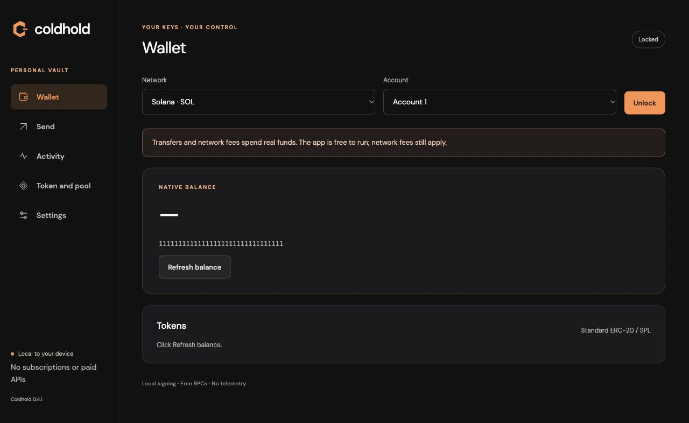

# Coldhold Desktop

Coldhold 0.4.2 is an English-language wallet with password + USB unlocking and the website’s charcoal and orange palette, geometric C logo and locally bundled DM Sans font. The application, local backend and native signer are included: no terminal, Node.js, Rust, Docker, server subscription or API key is required.

- **[Download for Windows x64 (.exe)](https://github.com/nish1-arch/coldhold-downloads/releases/download/v0.4.2/Coldhold-0.4.2-win-x64.exe)**
- **[Download for Mac with Apple Silicon (.dmg)](https://github.com/nish1-arch/coldhold-downloads/releases/download/v0.4.2/Coldhold-0.4.2-mac-arm64.dmg)**
- [Release notes, checksums and verification](https://github.com/nish1-arch/coldhold-downloads/releases/tag/v0.4.2)

On Windows, run the installer and open Coldhold from the desktop or Start menu. On an M-series Mac, open the DMG and drag Coldhold to Applications. Close Coldhold before installing an update. Intel Mac and Linux packages have not been updated for this release.

Branding preview from 0.4.1 with placeholder wallet data; 0.4.2 retains this appearance. The same branding is included in the Windows installer, app icons and Mac disk image.

## Three supported networks

| Network | Native asset | Connection |
| --- | --- | --- |
| Solana mainnet | SOL | Official public Solana RPC; selected by default |
| Elysium, chain 99901 | HYPE | Free Eleos community RPC, enabled |
| HyperEVM, chain 999 | HYPE | Official public Hyperliquid RPC, enabled |

Elysium uses `https://node.eleos.fun` and the explorer `https://elysiumexplore.com`. The provider publishes both in [Eleos documentation](https://eleos.fun/docs) and its [RPC reference](https://elysiumexplore.com/api-docs). During the launch window, signed transactions can wait for delivery through the HyperEVM inbox. This is a community connection with rate limits and no Coldhold uptime guarantee. A pending or unknown result should be checked using the saved operation; a new payment is a separate transaction.

Elysium and HyperEVM have separate balances. Coldhold does not bridge between them or provide HyperCore exchange trading. Development networks are absent from the desktop interface and cannot be used through its saved-transfer actions.

The wallet supports SOL/standard SPL transfers, HYPE/standard ERC-20 transfers, balances, token metadata, saved operations and transaction status. EVM history covers operations recorded by this app; automatic discovery of every token and complete external EVM history are not included. Token-2022 extensions are unsupported.

The Coldhold project token and pool belong on Elysium and **are not deployed**. Enabling a wallet RPC does not deploy launch contracts. The separate advanced Solana token/pool tools are for other tokens.

## Free local operation

The backend runs on the user's computer without a paid service or embedded provider credentials. Public RPC endpoints can be rate-limited or unavailable. Blockchain transfers still require the user's own SOL or HYPE for network fees. The app does not purchase services or silently switch to a paid provider.

## Recovery improvements in 0.4.2

An interrupted send can be retried from its saved operation using the same signed bytes. Missing or damaged activity metadata is rebuilt from the journals. A damaged account cache no longer prevents the app from starting and is repaired after authenticated unlock. Recovery with a matching phrase preserves the exact original encrypted vault bytes.

Elysium production token/pool preparation is implemented and exercised on a local chain. Its deployment manifest remains unconfigured: final owner parameters, canonical mainnet contract identity and public testnet verification are still required. No mainnet token/pool was deployed.

## Wallet and data

Connect a real USB drive, create or recover a wallet, record the recovery phrase offline, and unlock with the matching USB and password. The app does not format the drive or modify unrelated files. Sessions expire after five minutes; observed USB removal or changed secret material invalidates the session and pending approval. Each transfer needs separate native confirmation.

A USB flash drive is not a hardware wallet: its secret file can be copied, and malware running as the user can compromise an unlocked wallet. Keep the recovery phrase separately. No independent security audit has been completed.

Wallet data lives outside the installation folder: `%APPDATA%/Coldhold` on Windows and `~/Library/Application Support/Coldhold` on macOS. The Windows uninstaller preserves it. There is no automatic updater. Existing vault backups retain their original password and USB material.

See the [recovery and interrupted-payment guide](RECOVERY.md) for steps that do not require a terminal.

## Verification and distribution

The release includes `verification.json`, `SHA256SUMS.txt` and actual packaged-app/installer reports. They distinguish local-chain execution from public RPC reads and simulation. No real-funds mainnet transaction was broadcast during verification.

Windows installation, upgrade from the SHA256-pinned 0.4.0 release, same-version reinstallation, Unicode paths, shortcuts, application launch, uninstall and profile retention were tested on a Windows Server 2022 runner. Profile retention uses an artificial marker, not a real USB wallet migration. Physical USB removal/reinsertion on Windows and a separate Windows 10/11 manual GUI session remain unverified.

Windows packages are unsigned; Mac packages have an ad-hoc signature without Apple notarization. OS reputation or security controls may warn or block. Removing the pre-release version suffix does not change these facts or establish an independent audit.

[Older releases](https://github.com/nish1-arch/coldhold-downloads/releases) contain earlier configurations. Use the links above for all three enabled networks. GitHub's Source code ZIP is not an application installer.

Coldhold is distributed under the [MIT license](LICENSE). Bundled components retain their own licenses; see [DEPENDENCIES.md](DEPENDENCIES.md).
